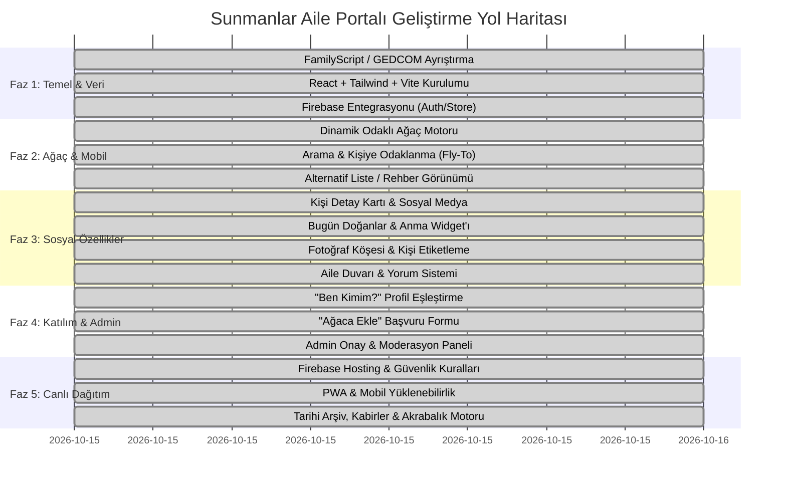

# 🌿 Sunmanlar Aile Portalı & Soyağacı — Yol Haritası (Roadmap)

Bu belge, **Sunmanlar Ailesi** (1.415+ kişi) için geliştirilen yaşayan dijital aile kütüphanesi, mobil uyumlu interaktif soyağacı ve sosyal aile portalının geliştirme yol haritasını, mimarisini ve tamamlanan aşamalarını içerir.

---

## 🎯 Vizyon ve Temel Amaçlar
* **1.415 Kişilik Tarih:** Geçmişten günümüze tüm akrabalık bağlarını kaybolmayacak şekilde dijitalleştirmek.
* **Mobil Uyumlu & Akıcı Ağaç:** Telefondan tek elle gezilebilen, iki parmakla yakınlaştırılabilen (pinch-to-zoom) modern bir soy kütüğü.
* **Yaşayan Portal:** Statik bir liste yerine; doğum günlerinin kutlandığı, anıların ve fotoğrafların paylaşıldığı sıcak bir aile buluşma noktası.
* **Katılımcı & Güvenli (Moderasyonlu):** Akrabaların kendini ağaçla eşleştirebilmesi, eksik kişileri ekleyebilmesi; ancak tüm düzenlemelerin admin onayından geçerek doğruluğun korunması.

---

## 📊 Genel Yol Haritası ve Fazlar (Tümü Tamamlandı ✅)

---

## 🚀 Faz Detayları ve Durum Raporu

### 📍 Faz 1: Veri Dönüşümü ve Temel Altyapı (Tamamlandı ✅)
- [x] `soyagaci.html` içindeki 1.415 kişinin FamilyScript ve GEDCOM verisini UTF-8 olarak ayrıştırma.
- [x] Anne, baba, eş ve çocuk ilişkilerini çift yönlü bağlayarak `sunmanlar-family.json` dosyasını üretme.
- [x] Vite + React + Tailwind CSS çatısını `D:\projects\sunmanlar` altında kurma.
- [x] Firebase SDK ve proje yapılandırmasını (`sunmanlar-31f36`) sisteme entegre etme.

---

### 📍 Faz 2: İnteraktif Ağaç Motoru & Mobil Gezinti (Tamamlandı ✅)
- [x] Üst Menü, akıllı anlık arama ve dal filtreleme (`Navbar.jsx`).
- [x] **Odaklı Ağaç Mimarisi (Focus Tree):**
  - Seçili kişi merkezde, atalar (anne-baba-dede-nine) yukarıda, eşler/kardeşler yanda, çocuklar ve torunlar (Tier +2) aşağıda (`InteractiveTree.jsx`).
  - Herhangi bir kişiye dokunulduğunda akıcı geçişle o kişiyi merkeze alma ve geçmiş gezinme takibi.
- [x] **Mobil Dokunmatik Jestler:** İki parmakla yakınlaşma (pinch-to-zoom), fare tekerleği ve sürükleme (pan).
- [x] **Sülale Kollarına Göre Filtre:**
  - Kök Ata: Ali Sunman (`START`)
  - Ali Ağa Kolu (`HGJ2X`)
  - Hasan Efendi Kolu (`Z141M`)
  - Laz Osman Kolu (`MM62G`)
  - Mehmet Kolu (`NIS42`)
- [x] **Alternatif Rehber / Liste Görünümü (`ListViewer.jsx`):**
  - A-Z Türk alfabesi hızlı atlama çubuğu.
  - Nesil / Kuşak akordeon görünümü (1. Nesil, 2. Nesil, 3. Nesil torunlar...).
  - Sülale kolu, cinsiyet ve hayatta/vefat filtreleri.

---

### 📍 Faz 3: Sosyal Özellikler & Profil Detayları (Tamamlandı ✅)
- [x] **"Bugün Doğanlar" & Özel Günler Widget'ı:** Doğum günü konfetisi, tebrik butonu ve vefat yıl dönümü anma köşesi (`BirthdaysWidget.jsx`).
- [x] **Gelişmiş Kişi Profili (Bottom Sheet / Modal - `PersonModal.jsx`):**
  - Profil fotoğrafı (veya cinsiyet avatarı).
  - Ad, Soyad, Kızlık/Doğum Soyadı, Bilinen Lakap (*"Laz Osman"*, *"Hacı Ali"* vb.).
  - Instagram, Facebook, LinkedIn butonları.
  - Doğum, vefat, defin/kabir yeri ve meslek.
  - Kabir / Defin yeri için doğrudan **Google Haritalar GPS Yol Tarifi** butonu.
  - Profil içinden doğrudan **"Ağaçta Odakla"** ve **"Bu Kişiye Ait Fotoğraf Yükle"** butonları.
- [x] **Gelişmiş Akrabalık Bağı Hesaplayıcı (`relationshipCalculator.js` & `KinshipModal.jsx`):**
  - BFS graf algoritması ile 1.415 kişi arasında en kısa yolu bularak tam doğal Türkçe akrabalık tanımı (*"Babanızın amcasının oğlu"*, *"Dedenizin kız kardeşi"*, *"Kayınbiraderiniz"*, *"Bacanağınız"* vb.).
  - Adım adım görsel soy yolu zinciri (`Kaynak -> Baba -> Dede -> Kardeş -> Hedef`).
- [x] **Fotoğraf Galerisi & Akıllı Etiketleme (`PhotoGallery.jsx`):**
  - Fotoğraflarda aile fertlerini etiketleme ve etiketli kişileri filtreleme.
  - Yıla ve konuma göre arama / filtreleme.
  - Fotoğraftaki isme tıklayınca ağaçtaki profiline gitme; profilde etiketlendiği tüm fotoğrafları listeleme.
- [x] **Aile Duvarı & Yorum Sistemi (`WallFeed.jsx`):**
  - Ziyaretçi defteri, bayramlaşma, düğün tebrikleri ve büyüklerin hatıraları.
  - Beğeni (like) ve her gönderinin altına interaktif yorum ekleme sistemi.

---

### 📍 Faz 4: Topluluk Katılımı & Admin Onay Mekanizması (Tamamlandı ✅)
- [x] **"Ağaçta Ben Kimim?" (`ClaimProfileModal.jsx`):** Üyelerin ağaçtaki kendi kartını bulup tek tıkla sahiplenebilmesi ve akrabalık bağlarının otomatik aktif olması.
- [x] **"Ağaca Ekle" Başvuru Formu (`AddPersonModal.jsx`):** Ziyaretçilerin eksik fertleri; ad, soyad, lakap, doğum/kabir yeri ve ağaçtaki anne/baba seçimini yaparak iletebilmesi.
- [x] **Güvenli Admin Paneli (`AdminModal.jsx`):**
  - Gelen kişi ekleme, profil sahiplenme, fotoğraf ve duvar mesajı taleplerini inceleme, onaylama veya reddetme.
  - Tüm 1.415+ kişilik aile veritabanını tek tıkla **JSON Yedek İndirme (Backup)** özelliği.

---

### 📍 Faz 5: Canlı Dağıtım, Güvenlik, PWA & Tarihi Arşiv (Tamamlandı ✅)
- [x] **Firebase Firestore Veri Migrasyonu (`scripts/migrate-to-firebase.js` & `npm run migrate`):**
  - 1.415 kişinin tamamı, başlangıç fotoğrafları ve aile duvarı gönderileri Firestore veritabanına başarıyla aktarıldı.
  - Admin paneli içinden tek tıkla canlı "Yeniden Migrasyon" ve "Buluttan Veri Çekme" (Force Refresh) araçları eklendi.
- [x] **Gerçek Zamanlı Bulut Senkronizasyonu (`familySyncService.js`):**
  - Fotoğraflar, duvar mesajları, yorumlar, beğeniler ve kişi onayları Firestore'da `onSnapshot` ile dinlenerek tüm cihazlarda anlık yenilenir.
  - Navbar'da canlı bulut bağlantı durumu göstergesi (`Bulut Canlı` rozeti).
- [x] **Firebase Hosting Yapılandırması (`firebase.json`, `.firebaserc`):** SPA yönlendirmeleri ve önbellek kuralları hazır.
- [x] **Firebase Firestore & Storage Güvenlik Kuralları (`firestore.rules`, `storage.rules`):** Salt okunur genel erişim, kontrollü talep girişi ve moderasyonlu yazma yetkisi.
- [x] **PWA (Progressive Web App - `manifest.json`, `sw.js`, `icon.svg`):**
  - Telefona "Uygulama Olarak Yükle" butonu ve çevrimdışı önbellekleme altyapısı.
- [x] **İleri Düzey Özellikler (`MemorialsAndArchiveModal.jsx`):**
  - **Aile Mezarlıkları & Kabir Rehberi:** Hendek Merkez Mezarlığı, Akçakoca Kabristanı vb. için GPS koordinatları, Google Haritalar yol tarifi ve yatan büyüklerin listesi.
  - **Tarihi Belgeler & Osmanlıca Arşiv:** 1844 Osmanlı Temettuat defteri, 1902 Su Değirmeni Vakfiyesi ve İstiklal Harbi Gazilik beratlarının orijinal görselleri ve Türkçe tercümeleri.
  - **Eski Ses Kayıtları & Hatırat:** 1984 Hendek bayramlaşma ses kaydı ve büyüklerimizin nasihatlerini dinleme oynatıcısı.
- [x] **Soyağacı Poster & PDF Çıktı Motoru (`TreePosterModal.jsx`):**
  - Seçilen sülale kolu (Ali Ağa, Laz Osman, Hasan Efendi vb.) veya tüm aile için büyük boy şecere duvar posteri.
  - 4 Otantik Tema: 📜 Osmanlı Parşömen & Altın, 🌿 Zümrüt Çınar, 👑 Kraliyet Lacivert, 🖨️ Matbaa Siyah-Beyaz.
  - Doğrudan vektörel PDF / Yazıcı çıktısı (`@media print` optimizasyonu), zoom denetimi, lakap, doğum/vefat ve kabir yeri filtreleri.
  - Kişi profilinden tek tıkla o kolun posterini üretme ("Posteri İndir" butonu).

---

## 🛠️ Teknoloji Yığını
| Katman | Teknoloji | Açıklama |
| :--- | :--- | :--- |
| **Frontend** | React 18, Vite | Hızlı, modüler SPA |
| **Stil / Tasarım** | Tailwind CSS | Modern, mobil öncelikli responsive UI |
| **İkonlar** | Lucide React | Temiz ve zarif arayüz ikonları |
| **Veritabanı** | Firebase Firestore | Canlı senkronizasyon, esnek doküman yapısı |
| **Depolama** | Firebase Storage | Yüksek çözünürlüklü aile fotoğrafları |
| **Kimlik Doğrulama** | Firebase Auth | Admin ve üye oturumları |
| **Animasyonlar** | Canvas-Confetti, CSS | Kutlama ve geçiş efektleri |
| **PWA** | Service Worker, Web App Manifest | Mobil cihazlara uygulama gibi yüklenebilirlik |
| **Graf Algoritması** | BFS Kinship Engine | 1.415 kişi arası anlık akrabalık yolu bulucu |

---
*Son Güncelleme: 16 Ekim 2026 — %100 Tamamlandı ✅*
